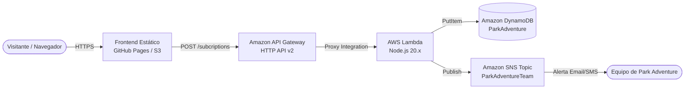

# 🌲 Park Adventure - Serverless Web & Cloud Infrastructure

Plataforma web cinematográfica e infraestructura serverless en AWS para el parque de aventuras y reserva natural **Park Adventure**.

---

## 🏗️ Arquitectura Serverless



---

## 🚀 Componentes del Proyecto

### 1. Frontend Web (Sin Node.js)
- **HTML5 & Vanilla JS**: Sin frameworks pesados ni dependencias de npm.
- **Tailwind CSS (CDN)**: Estilizado responsivo con paleta natural inspirada en el dosel del bosque.
- **Google Sans Flex**: Tipografía moderna variable.
- **Three.js (CDN)**: Escenario 3D interactivo procedural (isla *low-poly*, tirolina en movimiento, puente tibetano, fauna protegida, efectos día/ocaso/noche y parallax con ratón y scroll).
- **Lucide Icons (CDN)**: Iconografía vectorial limpia.
- **Formulario de Reserva**: Conectado directamente al API Gateway con cálculo dinámico de tarifas y emisión de ticket digital.

### 2. Backend Serverless (`lambda/index.mjs`)
- **Runtime**: Node.js 20.x (ES Modules).
- **AWS SDK v3**: Integración con `@aws-sdk/lib-dynamodb` y `@aws-sdk/client-sns`.
- **CORS Habilitado**: Soporte para llamadas preflight `OPTIONS` y `POST`.
- **Validación Robusta**: Validación de campos requeridos, formato de correo y sanitización.
- **Notificaciones SNS**: Envío automático de notificación con formato amigable al topic `ParkAdventureTeam`.

### 3. Infraestructura como Código (`terraform/`)
- **S3**: Bucket configurado para alojamiento de sitio web estático con carga automática de assets.
- **DynamoDB**: Tabla `ParkAdventure` en modo bajo demanda (`PAY_PER_REQUEST`).
- **SNS**: Tema `ParkAdventureTeam` con opción de suscripción de correo.
- **Lambda**: Empaquetado automático en ZIP y roles IAM de privilegios mínimos.
- **API Gateway**: API HTTP v2 con ruta `POST /subcriptions` y CORS habilitado.

---

## 📦 Parámetros y Endpoints Configurados

| Recurso | Identificador / Endpoint |
|---|---|
| **API Gateway Endpoint** | `https://etocy4tz5f.execute-api.us-east-1.amazonaws.com/dev/subcriptions` |
| **DynamoDB Table** | `arn:aws:dynamodb:us-east-1:131146365662:table/ParkAdventure` |
| **SNS Topic** | `arn:aws:sns:us-east-1:131146365662:ParkAdventureTeam` |
| **Región AWS** | `us-east-1` |

---

## 🌐 Guía de Despliegue

### Opción A: GitHub Pages
1. Ve a tu repositorio en GitHub: `aosaoye/parque-aventuras`.
2. Dirígete a **Settings** ➔ **Pages**.
3. En **Build and deployment** ➔ **Source**, selecciona **GitHub Actions**.
4. Cada vez que hagas `git push` a `main`, se publicará automáticamente en:
   `https://aosaoye.github.io/parque-aventuras/`

### Opción B: Despliegue en AWS con Terraform
```powershell
# 1. Entrar al directorio de Terraform
cd terraform

# 2. Inicializar los proveedores
terraform init

# 3. Revisar el plan de ejecución
terraform plan

# 4. Aplicar los cambios en AWS
terraform apply
```
Al finalizar, Terraform mostrará en la terminal los endpoints del sitio web en S3 y de la API.
